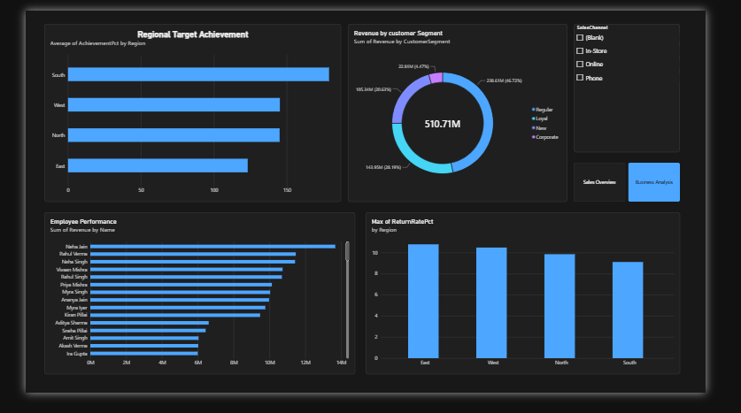

# Retail Business Performance Analysis & Dashboard

## About the Project

The **Retail Business Performance Analysis & Dashboard** project focuses on analyzing retail business data to understand sales performance, profitability, customer behavior, product performance, and store operations.

The project uses Python, Pandas, Excel, and Power BI to clean, process, analyze, and visualize retail data. It includes basic and advanced data analysis along with interactive dashboard visualizations to support better business decisions.

## Project Objectives

- Analyze overall retail sales and profit performance.
- Identify top-performing and low-performing products.
- Compare sales performance across different stores.
- Understand customer purchasing behavior.
- Analyze product returns and their impact on sales.
- Evaluate employee sales contributions.
- Study the relationship between discounts and profitability.
- Present important business insights through dashboards.

## Tools & Technologies

- **Python** – Data analysis and processing
- **Pandas** – Data cleaning, manipulation, and analysis
- **NumPy** – Numerical operations
- **Matplotlib & Seaborn** – Data visualization
- **Google Colab** – Python notebook execution
- **Microsoft Excel** – Data analysis and reporting
- **Power BI** – Interactive dashboard creation
- **GitHub** – Project storage and documentation

## Dataset Files

The project uses the following datasets:

- `customers.csv`
- `employees.csv`
- `order_items.csv`
- `orders.csv`
- `products.csv`
- `returns.csv`
- `stores.csv`
- `targets.csv`

## Project Structure

```text
Retail-Business-Performance-Dashboard/
│
├── Retail_Business_Analysis.ipynb
├── Retail_Sales_Advanced_Analysis.ipynb
├── Retail-Business-Performance-excel.xlsx
│
├── customers.csv
├── employees.csv
├── order_items.csv
├── orders.csv
├── products.csv
├── returns.csv
├── stores.csv
├── targets.csv
│
├── 10 lowest selling products.png
├── 10 order value by customer segment.png
├── Discount level vs Profit margin.png
├── Month sales and return.png
├── Product sales vs Profit margin.png
├── Profit by sore and Product category.png
├── Return rate by store.png
├── Store sale compared with average.png
├── Top 10 developers by revenue.png
├── Top 10 employees by sale.png
│
├── dashboard1.png.png
├── dashboard2.png.png
│
└── README.md
```

## Project Implementation

### 1. Python – Basic Data Analysis

- Data loading and inspection
- Data cleaning and preprocessing
- Handling missing values and duplicates
- Sales and profit calculations
- Data grouping and aggregation
- Exploratory data analysis

### 2. Python – Advanced Data Analysis

The advanced analysis covers the following business questions:

1. Identify stores performing below average sales.
2. Find products with high sales but low profit margins.
3. Identify customers contributing the most revenue.
4. Analyze the monthly impact of returns on sales.
5. Evaluate employee sales contributions.
6. Calculate return rates by store.
7. Analyze the relationship between discount levels and profitability.
8. Identify low-selling products for promotional activities.
9. Calculate average order value by customer segment.
10. Analyze profit by store and product category.

### 3. Microsoft Excel

- Data analysis using Excel
- Pivot tables and summaries
- Sales and profit calculations
- Data visualization

### 4. Power BI Dashboard

- Interactive sales overview
- Business performance analysis
- Sales and profit KPIs
- Store and product comparisons
- Business insights through visual reports

## Data Analysis Visualizations

### 1. Top 10 Developers by Revenue


### 2. Top 10 Employees by Sale


### 3. Store Sales Compared with Average


### 4. Product Sales vs Profit Margin


### 5. Monthly Sales and Returns


### 6. Return Rate by Store


### 7. Discount Level vs Profit Margin


### 8. Profit by Store and Product Category


### 9. 10 Lowest Selling Products


### 10. Order Value by Customer Segment


## Power BI Dashboard Screenshots

### Dashboard 1 – Sales Overview


### Dashboard 2 – Business Analysis



## Key Business Insights

- Identifying stores with below-average sales helps highlight areas for improvement.
- Product sales and profit margin analysis helps evaluate product performance.
- Customer revenue analysis identifies valuable customer segments.
- Return rate analysis helps understand product and store-level issues.
- Discount analysis helps evaluate the effect of discounts on profitability.
- Employee sales analysis helps measure individual sales contributions.

## Project Outcome

This project provided practical experience in data cleaning, data manipulation, exploratory data analysis, business analysis, and dashboard development.

By combining Python, Excel, and Power BI, the project transforms raw retail data into meaningful business insights that can support data-driven decision-making.

## Author

**Ananya N Puthran**

BCA Student | Aspiring Data Analyst

