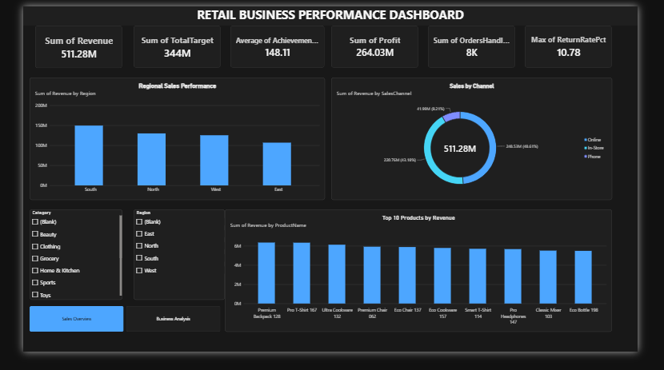

# Retail Business Performance Analysis & Dashboard

## Project Overview

This project focuses on analysing retail business data to understand sales performance, product performance, customer behaviour, employee contribution, store performance and overall business results.

The project uses **Python (Pandas), Google Colab, Microsoft Excel and Power BI** to clean and analyse retail datasets, answer business questions, generate insights and create interactive dashboards.

It includes two Python analysis notebooks:
- **Retail Business Analysis** – explores overall retail sales and business performance.
- **Retail Sales Advanced Analysis** – focuses on deeper business questions to support decision-making.

## Project Objectives

- Analyse overall retail sales and revenue.
- Identify top-performing products and employees.
- Compare sales performance across regions and stores.
- Understand customer segments and purchasing behaviour.
- Analyse sales channels and product categories.
- Evaluate sales target achievement.
- Examine product returns and common return reasons.
- Identify business improvement opportunities.
- Generate meaningful insights and recommendations.

## Tools & Technologies Used

- Python
- Pandas
- NumPy
- Matplotlib
- Google Colab
- Microsoft Excel
- Microsoft Power BI
- GitHub

## Project Structure

```text
Retail-Business-Performance-Dashboard/
│
├── README.md
├── Retail_Business_Analysis.ipynb
├── Retail_Sales_Advanced_Analysis.ipynb
├── Retail-Business-Performance-excel.xlsx
│
├── customers.csv
├── employees.csv
├── order_items.csv
├── orders.csv
├── products.csv
├── returns.csv
├── stores.csv
├── targets.csv
│
├── dashboard1.png.png
├── dashboard2.png.png
│
└── Screenshot/
    ├── 10 lowest selling products.png
    ├── 10 order value by customer segment.png
    ├── Discount level vs Profit margin.png
    ├── Month sales and return.png
    ├── Product sales vs Profit margin.png
    ├── Return rate by store.png
    ├── Profit by sore and Product category.png
    ├── Store sale compared with average.png
    ├── Top 10 developers by revenue.png
    └── Top 10 employees by sale.png
```

## Project Implementation

### 1. Python & Google Colab – Retail Business Analysis

Used Python libraries such as Pandas and NumPy to clean, process, combine and analyse retail datasets.

The analysis includes:

- Regional sales performance
- Product sales analysis
- Employee performance
- Customer spending analysis
- Customer segmentation
- Store performance
- Sales channel analysis
- Return analysis
- Regional target achievement

### 2. Python & Google Colab – Advanced Business Analysis

Created a separate notebook to explore additional business-focused questions and identify opportunities for improving retail performance.

The advanced analysis focuses on:

1. Identifying stores performing below average sales.
2. Finding high-sales products with low profit margins.
3. Identifying customers contributing the most revenue.
4. Analysing the impact of product returns on monthly sales.
5. Evaluating employee sales contributions.
6. Comparing return rates across stores.
7. Understanding the relationship between discounts and profitability.
8. Identifying low-sales products that may need promotional activities.
9. Comparing average order value across customer segments.
10. Analysing store and product category profitability.

These questions help move beyond basic sales reporting and provide insights that can support business decisions.

### 3. Microsoft Excel – Data Analysis

Used Excel functions and analytical tools to organise and analyse business data.

- Data cleaning and formatting
- Sales calculations
- Sorting and filtering
- Business performance analysis
- Summary tables and business insights

### 4. Microsoft Power BI – Interactive Dashboard

Developed a two-page interactive dashboard to present important business performance metrics and insights.

#### Page 1 – Retail Business Performance

- Six KPI cards
- Regional Sales Performance
- Sales by Channel
- Top 10 Products by Revenue
- Category Slicer
- Region Slicer

#### Page 2 – Business Analysis

- Sales Channel Slicer
- Regional Target Achievement
- Revenue by Customer Segment
- Employee Performance
- Maximum Return Rate

## Key Performance Indicators (KPIs)

- Total Revenue
- Sales Target
- Target Achievement
- Total Profit
- Total Orders
- Highest Return Rate

## Data Analysis Visualizations

Created 10 visualizations using Python and Matplotlib to explore different areas of retail business performance.

### 1. Top 10 Lowest-Selling Products


### 2. Order Value by Customer Segment


### 3. Discount Level vs Profit Margin


### 4. Monthly Sales and Returns


### 5. Product Sales vs Profit Margin


### 6. Return Rate by Store


### 7. Profit by Store and Product Category


### 8. Store Sales Compared with Average


### 9. Top 10 Developers by Revenue


### 10. Top 10 Employees by Sales


## Dashboard Screenshots

### Page 1 – Retail Business Performance



### Page 2 – Business Analysis


## Business Insights

The project helps identify:

- The highest-performing sales region.
- The most popular products.
- The best-performing employees.
- The highest-revenue customer segment.
- The strongest sales channel.
- Stores with higher product return rates.
- Products with low profitability.
- Customers contributing the most revenue.
- Regional sales target achievement.
- Opportunities to improve sales and profitability.

## Project Outcome

This project demonstrates how retail business data can be transformed into meaningful insights using Python, Excel and Power BI.

By combining basic and advanced data analysis with interactive dashboards and visualizations, the project helps understand business performance, identify improvement opportunities and support data-driven decision-making.

## Author

**Ananya N Puthran**

BCA Student | Aspiring Data Analyst
